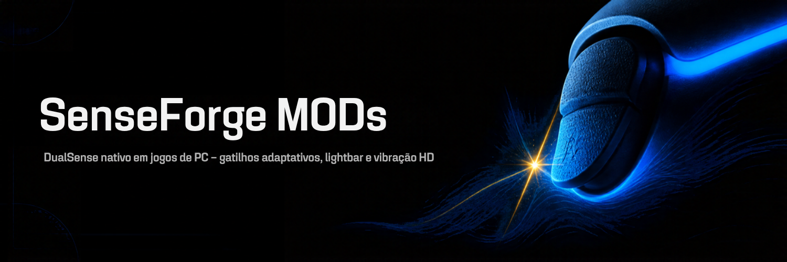

# SenseForge MODs

Suporte nativo ao **DualSense (PS5)** em jogos de PC: gatilhos adaptativos, lightbar, vibração HD e alto-falante do controle reagindo ao que acontece no jogo, em tempo real.

## MODs para download

| Jogo | Versão | Lançado em | Download | Guia |
| :--- | :---: | :---: | :---: | :---: |
| **Clair Obscur: Expedition 33** | v0.1.0 | - | *em breve* | [como instalar](mods/expedition-33.md) |

Todas as versões ficam em [Releases](https://github.com/Pedro-A-D-S/SenseForge-Mods/releases). Cada zip vem com um arquivo `.sha256` para conferir o download.

## Como funciona

Cada MOD é um add-on do [ReShade](https://reshade.me) (`senseforge.<jogo>.addon64`) com um perfil do jogo. Os ajustes ficam na aba **SenseForge** do overlay do ReShade (tecla **Home**): presets, perfis Fraco/Médio/Forte e ajuste de cada efeito. As dependências mudam de jogo para jogo e estão listadas no guia de cada MOD.

## Problemas e sugestões

Abra uma [issue](https://github.com/Pedro-A-D-S/SenseForge-Mods/issues) informando o jogo, a versão do MOD e o log mais recente de `%LOCALAPPDATA%\senseforge\logs\`.

---
SenseForge não tem relação com a Sony Interactive Entertainment nem com os estúdios dos jogos. DualSense e PlayStation são marcas da Sony Interactive Entertainment.
